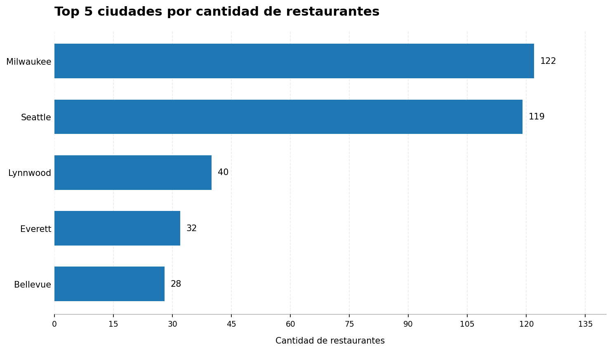
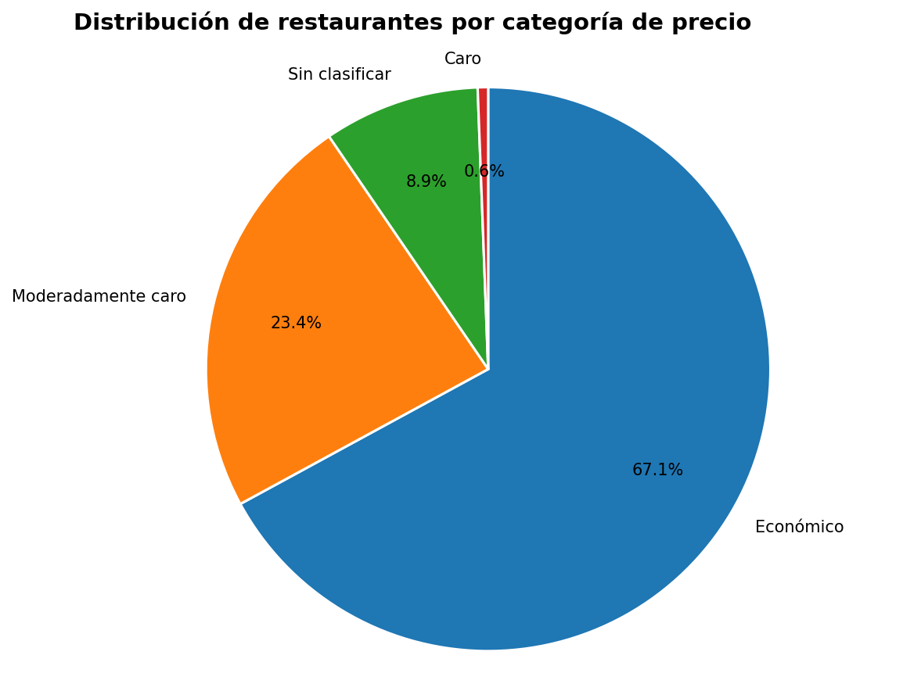
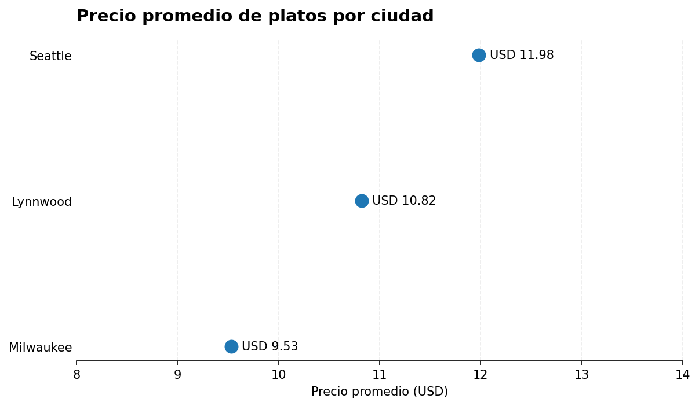
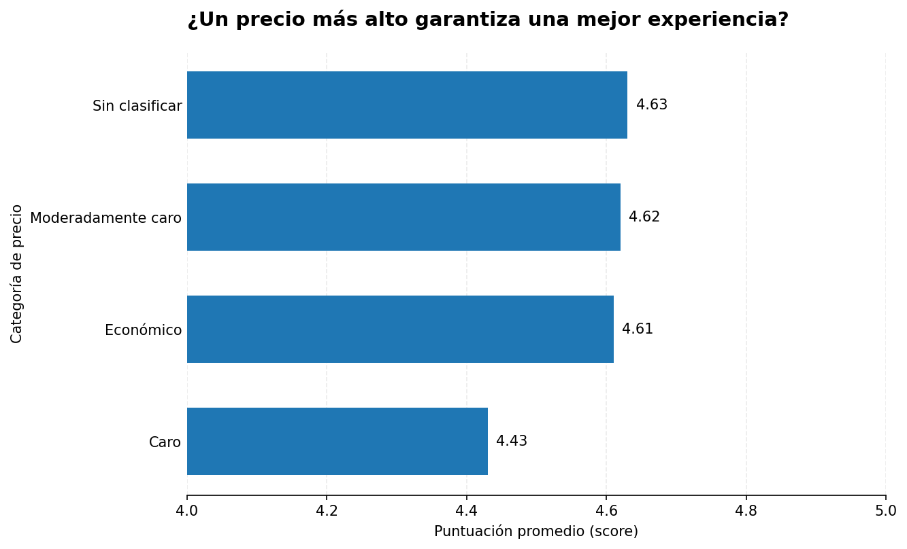

# Food Delivery ETL & Market Intelligence

Pipeline de integración de datos y análisis de mercado para restaurantes y menús.

## Descripción

Desarrollo de un pipeline ETL con Python y SQL para integrar datos de restaurantes y sus menús, aplicar reglas de limpieza y transformación, y construir una base consolidada para el análisis de mercado. El proyecto combina procesamiento de datos con Pandas, almacenamiento relacional en SQLite y consultas analíticas para identificar patrones geográficos, precios y puntuaciones de restaurantes.

## Tecnologías

Python · Pandas · SQL · SQLite · SQLAlchemy · Matplotlib · Databricks · GitHub

## Pipeline ETL

- **Extract:** lectura de archivos CSV de restaurantes y menús, inspección de dimensiones, tipos de datos y valores faltantes.
- **Transform:** normalización de categorías de precio, descomposición de direcciones, depuración de puntuaciones, conversión de precios a formato numérico y filtrado de restaurantes con más de 100 valoraciones. Integración de las fuentes mediante identificadores.
- **Load:** persistencia de los datos integrados en SQLite, en la tabla `master_food_data`, con validación del número de registros cargados.
- **Business Intelligence:** consultas SQL y visualizaciones para analizar la concentración geográfica de restaurantes, la distribución por categoría de precio, el precio promedio de los platos por ciudad y la relación entre precio y puntuación promedio.

## Resultados

- **63,221 registros** integrados y almacenados en SQLite.
- **122 restaurantes en Milwaukee** y **119 en Seattle**, las dos ciudades con mayor presencia en el conjunto analizado.
- **USD 11.98** de precio promedio por plato en Seattle, frente a **USD 9.53** en Milwaukee.
- **4.62 de puntuación promedio** para la categoría Moderadamente caro y **4.61** para Económico.

## Visualizaciones

Los siguientes gráficos resumen los principales hallazgos del análisis. Haz clic en una imagen para abrirla en tamaño completo.

### 1. Top 5 ciudades por cantidad de restaurantes

[](images/top_5_ciudades.png)

### 2. Distribución de restaurantes por categoría de precio

[](images/distribucion_restaurantes_categoria_precio.png)

### 3. Precio promedio de platos por ciudad

[](images/precio_promedio_ciudad.png)

### 4. Puntuación promedio por categoría de precio

[](images/puntuacion_promedio_categoria_precio.png)

## Estructura del proyecto

```text
proyecto-etl-delivery/
├── notebooks/
│   └── pipeline_etl_delivery.ipynb
├── restaurants.csv/
│   └── restaurants.csv
├── restaurant-menus.csv/
│   ├── restaurant_menus_parte_1.csv
│   └── ...
├── images/
│   ├── top_5_ciudades.png
│   ├── distribucion_restaurantes_categoria_precio.png
│   ├── precio_promedio_ciudad.png
│   └── puntuacion_promedio_categoria_precio.png
├── delivery_insights.db
└── README.md
```

## Reproducibilidad

El notebook documenta las etapas de extracción, transformación, carga y análisis. La ejecución requiere Python, las librerías utilizadas y acceso a los archivos de datos originales. Las rutas de entrada deben ajustarse al entorno donde se ejecute el proyecto.

## Autor

**Luis Olivera**

Proyecto de ingeniería de datos y análisis de mercado.